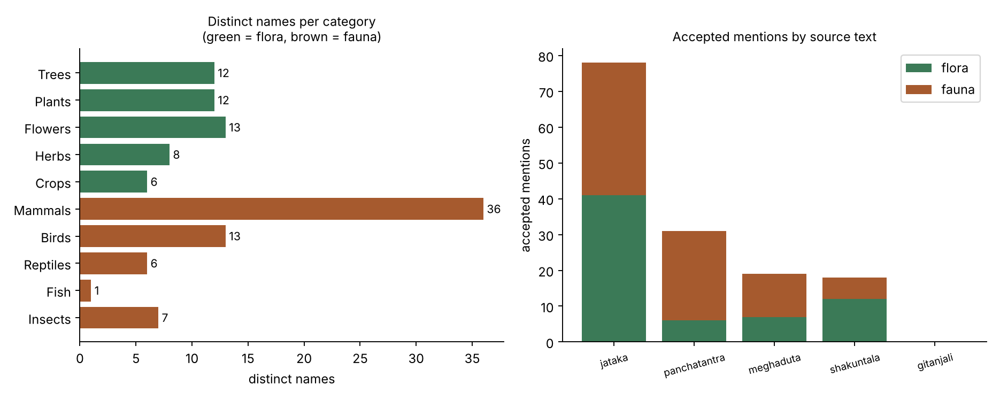

# Flora and Fauna in Indian Literature, extracted with RAG

**Assignment 2 · Extraction of Indian cultural elements using RAG · Monsoon Semester 2026**
Author: Siddhi Rashi Pandey · Digital Humanities and Social Sciences

**Abstract.** I wanted to know which plants and animals appear in a handful of classic Indian texts, without reading every page myself. I built a small retrieval-augmented generation (RAG) pipeline: the texts are cut into chunks, the chunks most likely to mention plants or animals are retrieved by embedding similarity, and a local LLM running in LM Studio lists the names it finds. Every name is then checked against the passage it came from. The result is 50 flora names and 63 fauna names, saved in [`flora_fauna.py`](flora_fauna.py) in the format the assignment asked for.



*Left: how many distinct names ended up in each of the ten categories. Right: how many accepted mentions each text produced. Categories are the ones the model chose, so the mistakes listed under "What to check" are counted where the model put them.*

---

## Files

| File or folder | Purpose |
|---|---|
| [`flora_fauna.py`](flora_fauna.py) | **The deliverable.** `flora_RAG_extraction` and `fauna_RAG_extraction` lists, plus `flora_evidence` and `fauna_evidence` dictionaries with category, mention count and source texts |
| [`flora_fauna_report.txt`](flora_fauna_report.txt) | The same results as a readable numbered list |
| [`config.py`](config.py) | Model names, chunk size, number of chunks retrieved and the search sentences for each category |
| [`build_index.py`](build_index.py) | Step 1: read the corpus, chunk it, embed the chunks |
| [`extract.py`](extract.py) | Step 2: retrieve chunks for each category, ask the LLM for names, check them |
| [`write_output.py`](write_output.py) | Step 3: count names and write `flora_fauna.py` and the report |
| [`make_summary_chart.py`](make_summary_chart.py) | Draws the figure above |
| [`corpus/`](corpus) | The five source texts (see the corpus README for sources) |
| `index/` | Saved chunks and their embedding vectors, so the index does not have to be rebuilt |
| [`results/extraction_raw.json`](results/extraction_raw.json) | Everything the model returned, split into `accepted` and `rejected` |

## How I did it

### 1. Choosing the corpus
I picked five public-domain English translations of Indian works, so they can be shared on GitHub. I chose English because a 7B local model reads English far more reliably than Sanskrit or Pali. I also wanted a mix of kinds of writing, so that the animals of the fables do not drown out everything else.

| Text | Why I included it |
|---|---|
| Kalidasa, *Shakuntala* (Ryder's translation) | a hermitage forest: deer, bees, creepers, jasmine |
| Kalidasa, *Meghaduta* (Wilson's translation) | a cloud travels across India, so the landscape changes in almost every verse |
| Tagore, *Gitanjali* | rivers, lotus, birds, monsoon imagery |
| *The Panchatantra* (Ryder's translation) | animal fables, so fauna everywhere |
| *The Jataka* (Cowell's edition) | birth stories of the Buddha with animals, trees and village crops |

### 2. Chunking
`build_index.py` removes any Project Gutenberg licence text and cuts each book into pieces of about 1200 characters with 200 characters of overlap. It prefers to cut at a line break or a space, and the overlap means a sentence on the border of two chunks is not lost. This gave **2,310 chunks**: Jataka 953, Panchatantra 583, Shakuntala 376, Meghaduta 302, Gitanjali 96.

### 3. Embedding
Each chunk is sent to the embedding model `nomic-embed-text-v1.5`, served by LM Studio, and comes back as a 768-number vector. The vectors are saved in `index/embeddings.npy` and the chunk text in `index/chunks.json`.

### 4. Retrieval
`config.py` has ten categories (Trees, Plants, Flowers, Herbs, Crops, Mammals, Birds, Reptiles, Fish, Insects), the same ones as the assignment sheet, and I wrote **two search sentences for each**, for example *"birds, peacocks, swans, parrots and cuckoos"* and *"crane, goose, crow, owl or other bird"*. `extract.py` embeds those sentences, compares them with every chunk by cosine similarity, and keeps the **6 closest chunks per category**. A chunk retrieved for more than one category is only sent to the LLM once.

### 5. Extraction
Each retrieved chunk goes to `qwen2.5-7b-instruct` (also in LM Studio, temperature 0) with a strict instruction: list the plants and animals named in the passage, use the name as written, only real organisms, put each in one of the ten categories, and reply with JSON only.

### 6. Checking the model
Small local models sometimes add a plausible animal that the passage never mentions. So a name is accepted only if its category is one of the ten allowed ones **and** the name literally appears in the chunk it came from. Everything else is not thrown away but saved under `rejected` in `results/extraction_raw.json`, so I can see what the model got wrong.

| | Count |
|---|---|
| Accepted mentions | 146 |
| Rejected: category not one of the ten | 30 |
| Rejected: name not found in the passage | 5 |

### 7. Writing the output
`write_output.py` merges the accepted rows, counts how often each name appears, orders names by frequency, and writes `flora_fauna.py` using the header from the assignment sheet.

## Output

The two required lists, from [`flora_fauna.py`](flora_fauna.py) (first ten of each, ordered by mentions; the full lists have 50 and 63 names):

```python
flora_RAG_extraction = ['lotus', 'jasmine', 'lilies', 'flowers', 'mango-tree',
                        'trees', 'acacias', 'aloe', 'ashoka-tree', 'assakanua', ...]

fauna_RAG_extraction = ['jackal', 'lion', 'deer', 'monkey', 'bees',
                        'crocodile', 'jackals', 'lions', 'peacock', 'snake', ...]
```

Most frequent names and where they were found:

| Flora | Mentions | Texts | Fauna | Mentions | Texts |
|---|---|---|---|---|---|
| lotus | 8 | Jataka, Meghaduta, Panchatantra, Shakuntala | jackal | 4 | Jataka, Panchatantra |
| jasmine | 4 | Jataka, Panchatantra, Shakuntala | lion | 4 | Jataka, Panchatantra, Shakuntala |
| lilies | 4 | Jataka | deer | 3 | Jataka, Meghaduta, Panchatantra |
| mango-tree | 2 | Shakuntala | monkey | 3 | Panchatantra |
| ashoka-tree | 1 | Shakuntala | peacock | 2 | Meghaduta, Shakuntala |

A few things stand out. The lotus is the only plant that shows up in four of the five texts. The Jataka gives the most hits (78) simply because it is the biggest text. Mammals dominate the fauna (36 distinct names) while fish have almost no presence (1). *Gitanjali* produced **no accepted names at all**. I did not dig into why. Either none of its chunks ranked in the top 6 for any category (it is the shortest text, so the bigger texts crowd it out), or the model found nothing it could name. Raising `TOP_K` would be the first thing to test.

## What to check, and the limits of this method

I read through the results and these are the problems I found, so anyone using the list knows about them:

- **Some names are filed in the wrong category.** *elephant* is under Reptiles; *fish*, *crab* and *frog-king* are under Mammals; *mango* is under Crops while *mango-tree* is under Trees; *cotton* and *indigo* are under Flowers. The model followed the category list but not common sense.
- **Some entries are too general** to count as a species: *trees*, *flowers*, *herbs*, *birds*, *boughs*.
- **Some entries are Pali or old-English names** from the Jataka translation (for example *assakanua*, *najjuha*, *puttajiva*, *pard*). They may be real organisms, but I could not confirm them quickly, so I left them in and did not guess.
- **Singular and plural both appear** (*lion* and *lions*, *jackal* and *jackals*) even though the prompt asked for singular. I did not merge them, so the counts split.
- **Metaphors count.** A lotus used as an image for a face is still a lotus in the text. I kept those, because in a cultural reading the images matter as much as the real plants.
- **Retrieval only covers the top chunks per category**, so a plant in a chunk that never ranks high is missed. Raising `TOP_K` in `config.py` gives a more complete list but takes longer.
- **The corpus is scanned text.** All five files come from scanned books (Internet Archive and Google Books), so there is OCR noise and some library stamps at the start. The Gutenberg-stripping step does nothing on these.
- **Embedding prefixes.** `config.py` has `DOC_PREFIX` and `QUERY_PREFIX` strings that are put in front of the text before embedding. They are not the prefixes the nomic model documents (`search_document: ` and `search_query: `). I left them as they were when the results were produced, so retrieval is probably a little weaker than it could be, and a rerun with the documented prefixes is the first improvement I would try.

## How to run it again

You need Python 3.9 or newer and [LM Studio](https://lmstudio.ai).

1. In LM Studio, download one embedding model (I used `nomic-embed-text-v1.5`) and one chat model (I used `qwen2.5-7b-instruct`).
2. Open the Developer tab, load both models and start the local server. The default address is `http://localhost:1234`.
3. Put the exact model names in `config.py`.
4. Run:

```bash
pip install -r requirements.txt
python build_index.py
python extract.py
python write_output.py
python make_summary_chart.py   # optional, needs matplotlib
```

If a call to LM Studio fails, the usual causes are a wrong model name in `config.py` or the server not being started.

## Link for the website

Replace `USERNAME` and `REPOSITORY` with the real names before submitting.

| File | URL |
|---|---|
| flora_fauna.py | https://github.com/USERNAME/REPOSITORY/blob/main/flora_fauna.py |
